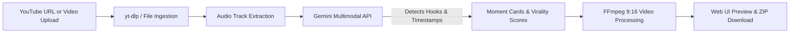

# 🎬 ClipPulse AI — Video Clipping Engine

An automated AI-powered video clipping engine that turns long-form YouTube videos and local uploads into viral **Shorts, Reels, and TikToks** using **Google Gemini Multimodal API** and **FFmpeg**.

---

## ✨ Features

- **Dual Input Modes**:
  - 🔗 **YouTube URL**: Instant stream download & metadata extraction via `yt-dlp`.
  - 📁 **File Upload**: Direct drag-and-drop for local MP4, MOV, MKV, or WebM files.
- **Multimodal AI Hook Detection**:
  - Leverages Google Gemini's audio & visual understanding to detect high-retention moments, emotional spikes, punchlines, and curiosity hooks.
  - Generates viral hook breakdown, retention score (1-100), social captions, and trending hashtags.
- **Automated Social Formatting**:
  - 📱 **Vertical 9:16 (Blurred Podcast Style)**: Crisp centered foreground with blurred, zoomed background padding (the industry standard for podcasts and interviews).
  - 🎯 **Vertical 9:16 (Center Crop)**: Dynamic center-crop fill.
  - 🖥️ **Horizontal 16:9**: Clean original aspect ratio chapters.
- **Modern Creator Dashboard**:
  - Sleek dark-mode Web UI with live progress tracking (0% → 100%).
  - In-browser clip player modal.
  - 1-click **Copy Caption & Hashtags** ready for posting.
  - Download individual clips or **Download All as a ZIP package**.
- **CLI & REST API**:
  - Run from the command line for headless automated batch pipelines.

---

## 🛠️ Architecture & Flow



---

## 🚀 Quickstart

### Prerequisites
- macOS or Linux
- **FFmpeg** installed on your system
- **Google Gemini API Key** (Free from [Google AI Studio](https://aistudio.google.com/apikey))

### 1. One-Click Setup (macOS)
```bash
cd /Users/raymond/.gemini/antigravity/scratch/video-clipping-engine
./setup.sh
```

### 2. Manual Setup
```bash
# 1. Install system tools (if not already installed)
brew install ffmpeg yt-dlp python

# 2. Create virtual environment
python3 -m venv venv
source venv/bin/activate

# 3. Install Python dependencies
pip install -r requirements.txt

# 4. Set Gemini API Key
cp .env.example .env
# Edit .env and paste your GEMINI_API_KEY
```

### 3. Launch the Web Dashboard
```bash
./run.sh
# Or:
python3 app.py
```
Open your browser to: **[http://localhost:8000](http://localhost:8000)**

---

## 💻 CLI Usage (Headless Mode)

Clip videos directly from your terminal:

```bash
# Clip a YouTube video with podcast blurred background
python cli.py --url "https://www.youtube.com/watch?v=dQw4w9WgXcQ" --style vertical_blur --max-clips 5

# Clip a local video file
python cli.py --file "./my_interview.mp4" --style vertical_crop --min-duration 20 --max-duration 60

# Find specific moments with a custom focus prompt
python cli.py --url "https://youtu.be/..." --focus "Find the funniest jokes and reactions"
```

---

## 📂 Project Structure

```
video-clipping-engine/
├── app.py                  # FastAPI server & background job queue
├── cli.py                  # Standalone command-line clipping utility
├── setup.sh                # Automated setup script
├── run.sh                  # One-click launcher
├── requirements.txt        # Python dependencies
├── .env.example            # Environment variables template
├── clipper/
│   ├── __init__.py
│   ├── schemas.py          # Pydantic models for moments and tasks
│   ├── downloader.py       # yt-dlp YouTube video & audio extractor
│   ├── analyzer.py         # Google Gemini multimodal viral detector
│   └── video_processor.py  # FFmpeg 9:16 vertical render engine
├── static/
│   ├── index.html          # Creator dashboard web interface
│   ├── app.js              # Live progress, preview modal & clipboard
│   └── styles.css          # Dark-mode styling & animations
├── uploads/                # Temporary user uploads
└── output/                 # Rendered video clips & ZIP packages
```

---

## 🔑 Setting Your Gemini API Key
You can configure your key in two convenient ways:
1. In the `.env` file: `GEMINI_API_KEY=AIzaSy...`
2. Directly inside the **Web Dashboard** via the top-right **"API Key"** button (saved securely in your local browser).
